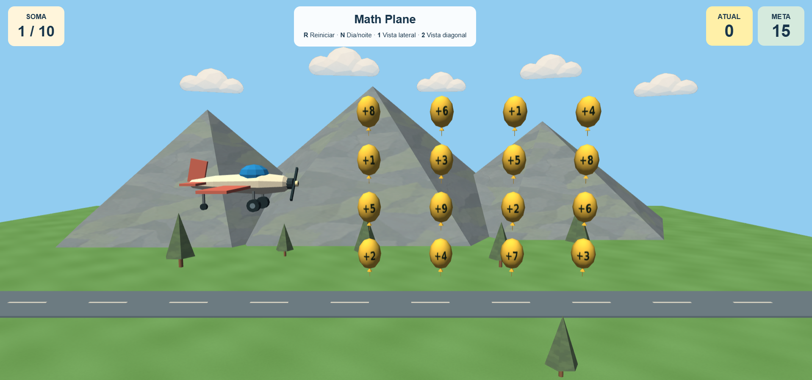
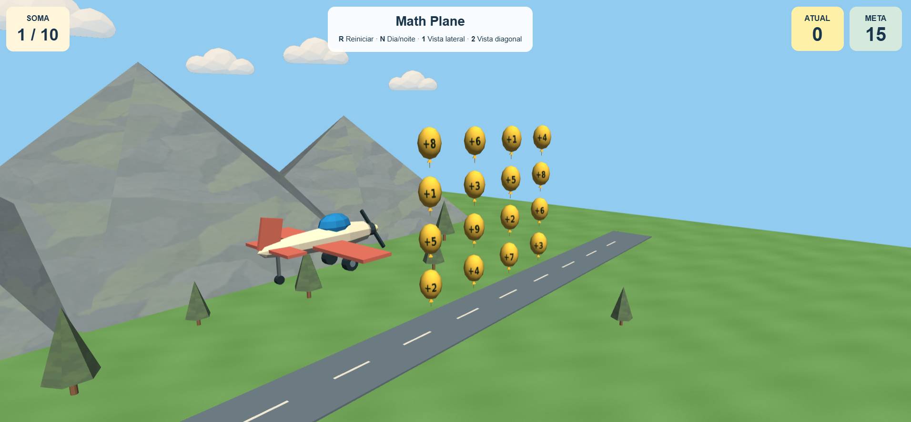
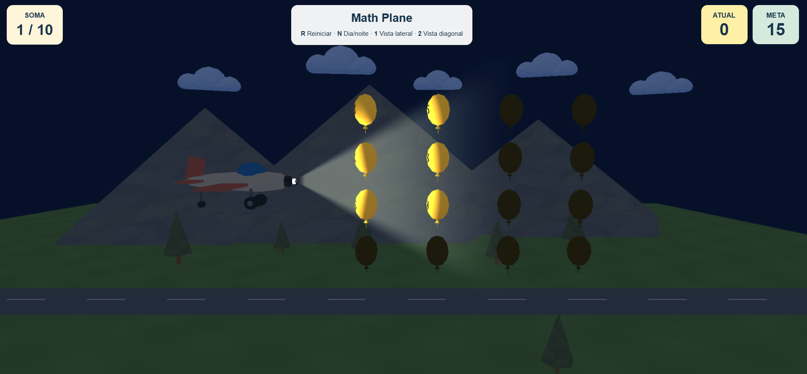
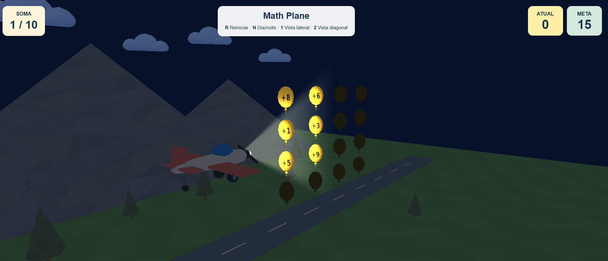

# Math Plane

**Atividade 4 - Texturas e materiais**

Computação Gráfica · UNIFESP

**Integrantes:** Enzo Ascaneo e Isabela Montandon Bustamante.

## O que foi entregue

Nesta etapa, aplicamos texturas ao avião, aos balões e aos elementos do cenário, mantendo o visual geométrico do Math Plane. O projeto utiliza WebGL puro, JavaScript, HTML e CSS.

### Aplicação de múltiplas texturas

- **Avião:** textura em tons de creme na fuselagem.
- **Balões:** texturas amarelas com números para representar as futuras operações matemáticas.
- **Cenário:** texturas de grama no chão, rocha nas montanhas, casca nos troncos e folhagem nas copas das árvores.
- **Nuvens:** imagens com transparência para compor o céu.

As imagens utilizadas estão na pasta [`texturas`](../../projeto/texturas/), junto ao código-fonte do projeto.

### Mapeamento de texturas

As coordenadas UV são definidas em `geometry.js` e associam as imagens às superfícies dos modelos. O mapeamento acompanha o comprimento e o contorno da fuselagem, distribui a textura sobre os balões e ajusta sua orientação nos elementos do cenário.

No chão e nas montanhas, a repetição dos padrões evita esticar uma única imagem sobre superfícies grandes. Nos balões, os números ficam na região central para facilitar a leitura.

### Integração com a iluminação

Mantivemos as fontes de luz da entrega anterior: o sol durante o dia e o farol do avião à noite. A cor das texturas é combinada com o cálculo de iluminação nos shaders.

Durante o dia, as texturas do avião e do cenário ficam mais visíveis. À noite, o farol destaca os balões próximos, e a câmera diagonal favorece a leitura dos números iluminados.

## Complementos visuais

Também acrescentamos a rotação contínua da hélice e um painel com o desafio **Soma 1/10**, o valor **Atual** e a **Meta**.

Nesta entrega, o avião permanece parado e os valores do painel são fixos. A movimentação, a coleta de balões, as regras e a pontuação serão desenvolvidas na Entrega 05.

## Como testar

[Demonstração online](https://isabelamontandon.github.io/ComputacaoGrafica/MathPlane/projeto/)

Para execução local, o arquivo [`index.html`](../../projeto/index.html) pode ser aberto pelo Live Server do VS Code ou por outro servidor HTTP, mantendo os arquivos e a pasta `texturas` na estrutura original.

| Tecla | Função |
| --- | --- |
| **1** | Câmera lateral |
| **2** | Câmera diagonal |
| **N** | Alternar entre dia e noite |
| **R** | Restaurar o estado inicial da cena |

O código-fonte atualizado está na pasta [`MathPlane/projeto`](../../projeto/).

## Demonstração

As capturas mostram as texturas nas duas câmeras e sua interação com a iluminação nos modos dia e noite.

[Abrir a pasta de demonstração](demonstracao/)

### Câmera lateral — dia

### Câmera diagonal — dia

### Câmera lateral — noite

### Câmera diagonal — noite

